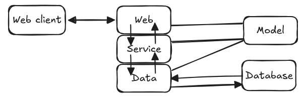

# 构建Web服务

## 三层架构



- Web层（网络层）：用来提供Web界面
- Service层（服务层）：用来实现业务逻辑
- Data层（数据层）：整个Web服务的核心组件
- Database 数据库
- Model 数据模型

## 目录结构

-- src(app) 网站所有代码都放在 src

--- web 程序的Web层

```
接收上传的 Excel 文件，校验后缀、大小
调用 Service 层方法，不解析 Excel 内容、不做编码逻辑
```

--- service 业务逻辑层

```
使用 pandas/openpyxl 读取 Excel 内容；
执行你之前的哈希算法，生成 10 位 PG 合法短编码；
数据清洗、去重、字段合法性校验；
调用 curd 层批量写入数据库。
```

--- data(curd) 储存接口层

```
只提供批量插入、查重查询方法，纯数据库操作，不处理 Excel 解析。
```

--- model 用来存放数据模型

--- core 只放和项目启动、运行环境强绑定的内容，不写业务工具函数。

```
core/
├── config.py      # 环境变量、全局配置（数据库地址、密钥、跨域、OSS、文件路径）
├── db.py          # SQLAlchemy引擎、Session工厂、数据库连接池（DAO底层依赖）
├── security.py    # JWT、密码哈希、权限校验底层方法

core/
├── logger.py      # loguru全局日志配置、日志格式、滚动策略
├── exceptions.py  # 全局自定义异常类、异常处理器
├── middlewares.py # FastAPI全局中间件（请求耗时、CORS、日志记录
```

--- utils 纯静态工具函数、无状态、可随处导入调用 不依赖 db 会话、不依赖全局 app 实例，输入参数出结果，纯工具能力。

```
utils/
├── __init__.py
├── excel_utils.py      # Excel读取/写入、Pandas解析、模板生成（映射表导入导出核心）
├── str_utils.py        # 字符串处理：10位参数编码哈希生成（就是你Excel那套算法Python版）、中文清洗
├── file_utils.py       # 文件校验、后缀判断、临时文件读写、路径拼接
├── gis_utils.py        # GIS空间工具：坐标系转换、KML生成、几何处理（你的老业务）
├── date_utils.py       # 日期格式化、时间戳转换
├── encrypt_utils.py    # 简单加解密、编码转换
```

