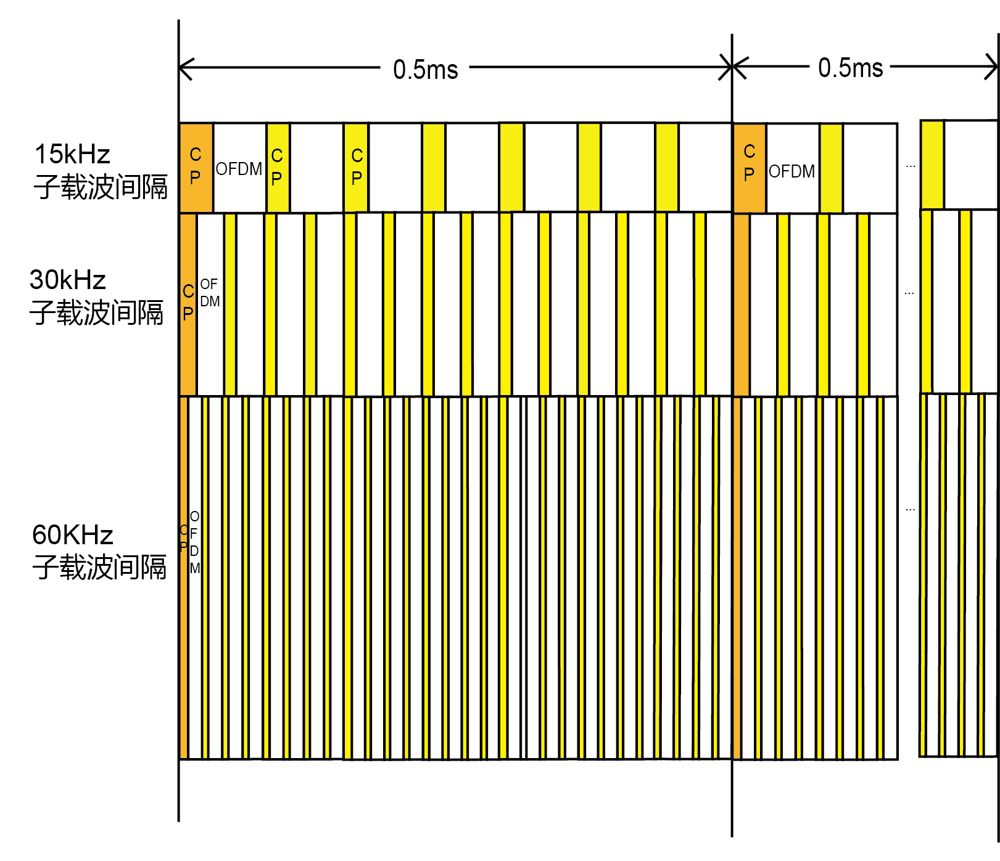
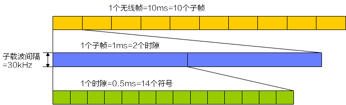
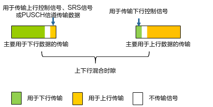
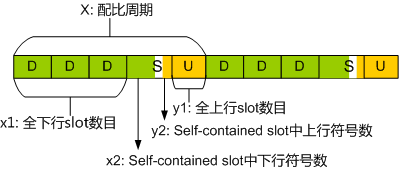
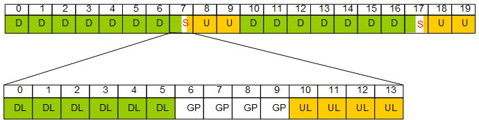
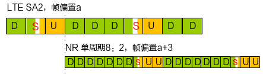
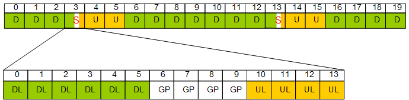
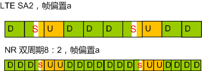
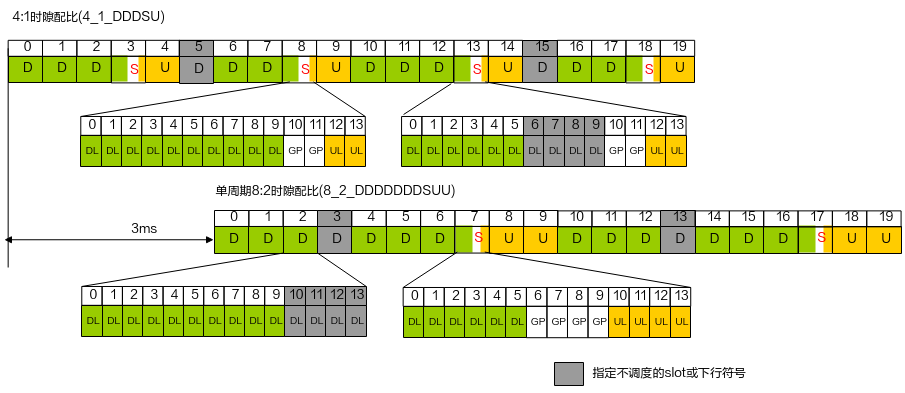
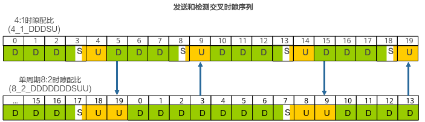

# 无线功能

## 基础功能

### 3GPP 协议

#### LDPC+Polar码

LDPC（Low Density Parity Check）和Polar码是3GPP R15协议新引入的空口信道编码方式，详细描述请参见3GPP TS 38.212 V15.5.0。

##### LDPC

**LDPC属于线性分组码，应用于5G eMBB(Enhanced Mobile Broadband)业务数据信道**，LDPC通过校验矩阵进行编码，LDPC与LTE数据信道使用的Turbo码比较，译码速度快可以提升峰值速率，降低功耗，因此LDPC能更好满足5G业务的数据译码要求。

| 场景       | 速度比较             |
| ---------- | -------------------- |
| 低码率场景 | 两者的译码速度差不多 |
| 高码率场景 | LDPC的译码速度快很多 |

##### Polar码

**Polar码属于线性分组码，应用于5G eMBB控制信道。**Polar码通过编码矩阵进行编码，Polar码与LTE控制信道使用的卷积码比较，在相同的BLER(Block Error Rate)条件下，Polar码的SNR(Signal Noise Ratio)要求比卷积码更低。

#### 基本Numerology

3GPP R15协议引入了基本Numerology，定义了不同的子载波间隔的CP(Cyclic Prefix)长度，详细描述请参见3GPP TS 38.211 V15.5.0。CP包括Normal CP(常规循环前缀)和Extended CP(扩展循环前缀)两种类型，其中Extended  CP只有子载波间隔为60kHz的时候可以支持。以Normal CP为例，15kHz、30kHz、60kHz子载波间隔的符号对应关系

不同子载波间隔的CP长度在0.5ms内有如下特点：

- 第一个符号的CP长度大于其它符号的CP长度。
- 除了第一个符号的CP长度外，其它符号的CP的长度相等。

NR FDD场景下，当前版本基本Numerology支持的小区子载波间隔为15kHz。

NR TDD场景下，当前版本基本Numerology支持的小区子载波间隔为30kHz。3GPP TS 38.104 V16.6.0协议规定不同频段支持的子载波间隔。

**表10-1**  不同频段支持的子载波间隔

| 频段      | 支持的子载波间隔    |
| --------- | ------------------- |
| 小于1GHz  | 15kHz、30kHz        |
| 1GHz~6GHz | 15kHz、30kHz、60kHz |

和LTE一样，NR中的一个子帧长度为1ms。由于不同频段支持的子载波间隔不同，则一个子帧对应的时隙数可变，例如：15kHz对应1个时隙，30kHz对应2个时隙，60kHz对应4个时隙。每个时隙对应14个符号。以子载波间隔为30kHz为例，帧结构的示意图。

基本Numerology应用特点：

- 不同时延需求业务，可以采用不同的子载波间隔。子载波间隔越大，对应的时隙时间长度越短，可以缩短系统的时延。
- 不同移动速度的UE，产生的多普勒频偏不同，更高的移动速度产生更大的多普勒频偏。通过增大子载波间隔，可以提升系统对频偏的鲁棒性。
- 子载波间隔越小，对应的CP长度就越大，支持的小区覆盖半径也就越大。

#### Self-contained时隙(TDD)

Self-contained时隙即Self-contained slot，是3GPP R15支持的一种新的时隙格式。

通常，TDD模式中上行传输和下行传输通过时隙进行区分，上行时隙全部用于上行传输，下行时隙则全部用于下行传输。**Self-contained slot支持在一个时隙中同时包含上行传输和下行传输。**通过时分复用，使上行传输和下行传输分别位于同一时隙不同的OFDM符号上，如图11-1示。

**图11-1**  Self-contained时隙

Self-contained slot有两种结构，详细请见表11-1

**表11-1**  Self-contained slot结构介绍

| 结构分类         | 使用场景         | 剩余符号用途                                                 | 优点             |
| ---------------- | ---------------- | ------------------------------------------------------------ | ---------------- |
| DL-dominant slot | 主要用于下行传输 | 传输上行控制信号SRS（Sounding  Reference Signal）信号PUSCH信道传输数据 | 缩短下行反馈时延 |
| UL-dominant slot | 主要用于上行传输 | 传输下行控制信号                                             | 缩短上行调度时延 |

 

当前版本仅支持DL-dominant slot。

在Self-contained slot中，基站和UE都需要进行上下行传输的转换。通过预留时间（图11-1中的白色部分）保证上下行传输转换后仍可以正常工作，预留时间内不进行任何信号的发送或者接收，预留时间一般都是OFDM符号时间长度的整数倍。

#### 时隙配比(TDD)

##### 原理描述

###### 通用原理描述

在低频、子载波间隔为30kHz的场景下，支持的时隙配比如下：

- 4:1时隙配比(4_1_DDDSU)
- 单周期8:2时隙配比(8_2_DDDDDDDSUU)
- 双周期8:2时隙配比(8_2_DDDSUUDDDD)

在高频、子载波间隔为120kHz的场景下，支持的时隙配比如下：

- 4:1时隙配比(4_1_DDDSU)
- 2:3时隙配比(2_3_DSUUU)

###### 4:1时隙配比

**4:1时隙配比(4_1_DDDSU)，表示3个全下行时隙（D），1个上下行混合的时隙（S），1个全上行时隙（U）。**

在低频、子载波间隔为30kHz的场景下，支持4:1时隙配比(4_1_DDDSU)，如表12-1所示，举例见4:1时隙配比(4_1_DDDSU)举例说明。

在高频、子载波间隔为120kHz的场景下，支持4:1时隙配比(4_1_DDDSU)，如表12-2所示。

时隙配比配置说明表中相关参数字段的含义如下：

- X：配比周期

  由于高频和低频的子载波间隔不同，配比周期也会不同。

- x1：全下行slot数目

- y1：全上行slot数目

- x2：全下行slot后面的下行符号数

- y2：全上行slot前面的上行符号数

- GP(guard period)：上下行数据传输切换时的保护符号数

**表12-1**  低频场景下4:1时隙配比(4_1_DDDSU)的配置说明

| 时隙结构   | GP   | X（ms） | x1   | x2   | y2   | y1   |
| ---------- | ---- | ------- | ---- | ---- | ---- | ---- |
| SS1        | 1    | 2.5     | 3    | 11   | 2    | 1    |
| SS2        | 2    | 2.5     | 3    | 10   | 2    | 1    |
| SS3        | 3    | 2.5     | 3    | 9    | 2    | 1    |
| SS4        | 4    | 2.5     | 3    | 8    | 2    | 1    |
| SS5        | 5    | 2.5     | 3    | 7    | 2    | 1    |
| SS6        | 6    | 2.5     | 3    | 6    | 2    | 1    |
| SS01001202 | 12   | 2.5     | 3    | 0    | 2    | 1    |
| SS18       | 18   | 2.5     | 2    | 8    | 2    | 1    |

**表12-2**  高频场景下4:1时隙配比(4_1_DDDSU)的配置说明

| 时隙结构 | GP   | X（ms） | x1   | x2   | y2   | y1   |
| -------- | ---- | ------- | ---- | ---- | ---- | ---- |
| SS201    | 1    | 0.625   | 3    | 11   | 2    | 1    |
| SS202    | 2    | 0.625   | 3    | 10   | 2    | 1    |
| SS203    | 3    | 0.625   | 3    | 9    | 2    | 1    |
| SS204    | 4    | 0.625   | 3    | 8    | 2    | 1    |
| SS205    | 5    | 0.625   | 3    | 7    | 2    | 1    |
| SS206    | 6    | 0.625   | 3    | 6    | 2    | 1    |

由于一个slot对应14个符号，所以上表中GP符号数为18的情况，实际上是由GP和前面的下行符号，以及后面的上行符号共同组成两个Self-contained slot的结果。如4:1时隙配比(4_1_DDDSU)举例说明所示，时隙结构为SS18时，保护符号数GP为18，下行符号数x2为8，上行符号数y2为2，实际上组成了两个slot：一个slot是下行符号8个+GP符号6个，另一个slot是GP符号12个+上行符号2个，如图12-1所示。

**图12-1**  GP符号数为18时的示意图

 

上下行混合时隙即Self-contained slot，详细描述请参见Self-contained时隙(TDD)。

###### 4:1时隙配比(4_1_DDDSU)举例说明

**NRDUCell**.SlotAssignment(时隙配比)配置为“4_1_DDDSU”，**NRDUCell**. SlotStructure(时隙结构)配置为“SS2”，时隙结构SS2的参数字段（X，x1，x2，y2，y1）取值分别为（2.5, 3, 10, 2, 1），4:1时隙配比如图12-2所示。

**图12-2**  4：1时隙配比图（5ms）

######  8:2时隙配比

**单周期8:2时隙配比(8_2_DDDDDDDSUU)或双周期8:2时隙配比(8_2_DDDSUUDDDD)，表示7个全下行时隙（D），1个上下行混合的时隙（S），2个全上行时隙（U）。**

在低频、子载波间隔为30kHz的场景下：

- 单周期8:2时隙配比(8_2_DDDDDDDSUU)，如表12-3所示，举例见单周期8:2时隙配比(8_2_DDDDDDDSUU)举例说明。
- 双周期8:2时隙配比(8_2_DDDSUUDDDD)，如表12-4举例说明。

时隙配比配置说明表中相关参数字段的含义如下：

- X、Y：配比周期

  由于高频和低频的子载波间隔不同，配比周期也会不同。

- x1、x3：全下行slot数目

- y1、y3：全上行slot数目

- x2、x4：全下行slot后面的下行符号数

- y2、y4：全上行slot前面的上行符号数

- GP(guard period)：上下行数据传输切换时的保护符号数

**表12-3**  低频场景下单周期8:2时隙配比(8_2_DDDDDDDSUU)的配置说明

| 时隙结构 | GP   | X（ms） | x1   | x2   | y2   | y1   |
| -------- | ---- | ------- | ---- | ---- | ---- | ---- |
| SS51     | 1    | 5       | 7    | 9    | 4    | 2    |
| SS52     | 2    | 5       | 7    | 8    | 4    | 2    |
| SS53     | 3    | 5       | 7    | 7    | 4    | 2    |
| SS54     | 4    | 5       | 7    | 6    | 4    | 2    |
| SS55     | 5    | 5       | 7    | 5    | 4    | 2    |
| SS56     | 6    | 5       | 7    | 4    | 4    | 2    |
| SS518    | 18   | 5       | 6    | 6    | 4    | 2    |

**表12-4**  低频场景下双周期8:2时隙配比(8_2_DDDSUUDDDD)第一个周期的配置说明

| 时隙结构 | GP   | X（ms） | x1   | x2   | y2   | y1   |
| -------- | ---- | ------- | ---- | ---- | ---- | ---- |
| SS81     | 1    | 3       | 3    | 9    | 4    | 2    |
| SS82     | 2    | 3       | 3    | 8    | 4    | 2    |
| SS83     | 3    | 3       | 3    | 7    | 4    | 2    |
| SS84     | 4    | 3       | 3    | 6    | 4    | 2    |
| SS85     | 5    | 3       | 3    | 5    | 4    | 2    |
| SS86     | 6    | 3       | 3    | 4    | 4    | 2    |
| SS818    | 18   | 3       | 2    | 6    | 4    | 2    |

**表12-5**  低频场景下双周期8:2时隙配比(8_2_DDDSUUDDDD)第二个周期的配置说明

| 时隙结构 | GP   | Y（ms） | x3   | x4   | y4   | y3   |
| -------- | ---- | ------- | ---- | ---- | ---- | ---- |
| SS81     | 1    | 2       | 4    | 0    | 0    | 0    |
| SS82     | 2    | 2       | 4    | 0    | 0    | 0    |
| SS83     | 3    | 2       | 4    | 0    | 0    | 0    |
| SS84     | 4    | 2       | 4    | 0    | 0    | 0    |
| SS85     | 5    | 2       | 4    | 0    | 0    | 0    |
| SS86     | 6    | 2       | 4    | 0    | 0    | 0    |
| SS818    | 18   | 2       | 4    | 0    | 0    | 0    |

###### 单周期8:2时隙配比(8_2_DDDDDDDSUU)举例说明

**NRDUCell**.***SlotAssignment***(时隙配比)配置为“8_2_DDDDDDDSUU”，**NRDUCell**.***SlotStructure***(时隙结构)配置为“SS54”，一个配比周期5ms，包括10个时隙（对应子载波间隔30kHz），7个全下行时隙（D），1个上下行混合的时隙（S），2个全上行时隙（U），如图12-3所示。图12-3中的白色部分表示上下行数据传输切换时的保护符号GP。S时隙包括6个下行符号（DL），4个保护符号（GP），4个上行符号（UL）。

**图12-3**  单周期8：2时隙配比图（10ms）

在NR和LTE双模网络场景下，为了保持NR和LTE网络同步，必须保证双方的上行接收同步以及下行发送同步，否则一方的下行发送会对另一方的上行接收造成干扰。当**NRDUCell**.***SlotAssignment***(时隙配比)配置为“8_2_DDDDDDDSUU”时，可以通过调整配置让NR和LTE TDD（DSUDD子帧配比下）保持同步，避免共存或邻频时的干扰问题。

- 调整NR侧时隙配比（**NRDUCell**.***SlotAssignment***）、时隙结构（**NRDUCell**.***SlotStructure***）、帧偏置(**gNodeBParam**.***FrameOffset***或**gNBFreqBandConfig**.***FrameOffset***)。
- 调整LTE侧上下行子帧配比（**Cell**.***SubframeAssignment***）、特殊子帧配比（**Cell**.***SpecialSubframePatterns***）、帧偏置（**ENodeBFrameOffset**.***TddFrameOffset***或**CellFrameOffset**.***FrameOffset***)。

 

当前版本支持NR和LTE帧结构如下配套，且NR小区帧偏置生效值相对LTE小区帧偏置生效值滞后3ms，如图12-4所示：

- NR单周期8:2时隙配比(8_2_DDDDDDDSUU)、时隙结构SS54配套LTE上下行子帧配比SA2 、特殊子帧配比SSP7。
- NR单周期8:2时隙配比(8_2_DDDDDDDSUU)、时隙结构SS56配套LTE上下行子帧配比SA2 、特殊子帧配比SSP6。
- NR单周期8:2时隙配比(8_2_DDDDDDDSUU)、时隙结构SS518配套LTE上下行子帧配比SA2 、特殊子帧配比SSP5。

**图12-4**  NR和LTE网络同步帧结构图

###### 双周期8:2时隙配比(8_2_DDDSUUDDDD)举例说明

**NRDUCell**.***SlotAssignment***(时隙配比)配置为“8_2_DDDSUUDDDD”，**NRDUCell**.***SlotStructure***(时隙结构)配置为“SS84”，配比周期（第一周期3ms，第二周期2ms），如图12-5所示，其中：

- 第一个周期内3个全下行时隙（D），1个上下行混合的时隙（S），2个全上行时隙（U）。
- 第二个周期内4个全下行时隙（D），0个上下行混合的时隙（S），0个全上行时隙（U）。

图12-5中的白色部分表示上下行数据传输切换时的保护符号GP。S时隙包括6个下行符号（DL），4个保护符号（GP），4个上行符号（UL）。

**图12-5**  双周期8:2时隙配比图（10ms）

在NR和LTE双模网络场景下，为了保持NR和LTE网络同步，必须保证双方的上行接收与下行发送同步，否则一方的下行发送会对另一方的上行接收造成干扰。当**NRDUCell**.***SlotAssignment***(时隙配比)配置为“8_2_DDDSUUDDDD”时，可以通过调整配置让NR和LTE TDD（DSUDD子帧配比下）保持同步，避免共存或邻频时的干扰问题。

- 调整NR侧时隙配比（**NRDUCell**.***SlotAssignment***）、时隙结构（**NRDUCell**.***SlotStructure***）、帧偏置(**gNodeBParam**.***FrameOffset***或**gNBFreqBandConfig**.***FrameOffset***)。
- 调整LTE侧上下行子帧配比（**Cell**.***SubframeAssignment***）、特殊子帧配比（**Cell**.***SpecialSubframePatterns***）、帧偏置（**ENodeBFrameOffset**.***TddFrameOffset***或***CellFrameOffset***.***FrameOffset***）。

 

当前版本支持NR和LTE帧结构如下配套，且NR小区帧偏置生效值与LTE小区帧偏置生效值对齐，如图12-6示：

- NR双周期8:2时隙配比(8_2_DDDSUUDDDD)、时隙结构SS84配套LTE上下行子帧配比SA2 、特殊子帧配比SSP7。
- NR双周期8:2时隙配比(8_2_DDDSUUDDDD)、时隙结构SS86配套LTE上下行子帧配比SA2 、特殊子帧配比SSP6。
- NR双周期8:2时隙配比(8_2_DDDSUUDDDD)、时隙结构SS818配套LTE上下行子帧配比SA2 、特殊子帧配比SSP5。

**图12-6**  NR和LTE网络同步帧结构图

#####  DL Blanking功能

在边界区域同频段小区场景下，如果不同运营商配置了不同的时隙配比，那么某一时隙配比的下行符号（DL）会干扰另一时隙配比的上行符号（UL）或保护符号（GP）。如边界区域LTE系统演进到NSA组网系统时，为保证NR和LTE系统的帧同步，运营商选择单周期8:2时隙配比建站，而NR系统内其他运营商为追求更短时延采用4:1时隙配比建站，此时二者间即产生干扰。为此华为实现了DL Blanking功能，通过在基站处理不同的时隙配比，指定特定的下行符号不调度，以解决上述干扰问题。

 

单周期8:2时隙配比(8_2_DDDDDDDSUU)相比4:1时隙配比(4_1_DDDSU)需要多配置3ms的帧偏置，才能实现NR和LTE系统间，或者NR系统内不同时隙配比的帧同步，以减少干扰符号数，降低传输资源的浪费，详情可参见图12-4和图12-7。

当前版本支持4:1时隙配比(4_1_DDDSU)和单周期8:2时隙配比(8_2_DDDDDDDSUU)的DL Blanking功能。本功能仅低频支持，且仅适用于n77和n78频带。

本功能通过将参数**NRDUCell**.***PeerCellSlotAssignment***(对端时隙配比)配置为“4_1_DDDSU”或“8_2_DDDDDDDSUU”来开启，配置值和对端小区时隙配置保持一致，参见表12-6所示。

**表12-6**  启用DL Blanking功能参数配置

| 对端小区时隙配置                  | 本端小区时隙配置                  | 参数配置         |
| --------------------------------- | --------------------------------- | ---------------- |
| 4:1时隙配比(4_1_DDDSU)            | 单周期8:2时隙配比(8_2_DDDDDDDSUU) | “4_1_DDDSU”      |
| 单周期8:2时隙配比(8_2_DDDDDDDSUU) | 4:1时隙配比(4_1_DDDSU)            | “8_2_DDDDDDDSUU” |

DL Blanking功能的实现原理如下：

- 4:1时隙配比(4_1_DDDSU)的DL Blanking功能
  - 时隙结构为SS1 ~ SS6时：指定slot 3/13的符号6\~符号9中的下行符号不调度，即下行符号只能调度符号0~符号5，并且指定整个slot 5/15不调度。
  - 时隙结构为SS01001202和SS18时：因为slot 3/13的符号6~符号9为GP符号，本身就不调度，因此仅指定整个slot 5/15不调度。

- 单周期8:2时隙配比(8_2_DDDDDDDSUU)的DL Blanking功能

  指定slot 2/12的下行符号10\~下行符号13不调度，即下行符号只能调度符号0~符号9，并且指定整个slot 3/13不调度。

以4:1时隙配比的时隙结构SS2、单周期8:2时隙配比的时隙结构SS54为例，DL Blanking功能的示意图如图12-7所示。

**图12-7**  DL Blanking示意图（10ms）

##### 干扰源小区检测功能

在边界区域同频段小区场景下，如果不同运营商分别配置了4:1时隙配比(4_1_DDDSU)和单周期8:2时隙配比(8_2_DDDDDDDSUU)，为了部署DL  Blanking功能，首先需要识别出干扰源小区。干扰源小区检测功能通过让4:1时隙配比(4_1_DDDSU)和单周期8:2时隙配比(8_2_DDDDDDDSUU)的小区发送和检测交叉时隙序列，实现4:1时隙配比(4_1_DDDSU)和单周期8:2时隙配比(8_2_DDDDDDDSUU)的干扰源小区检测，本功能中交叉时隙序列的详细信息请参见***[交叉时隙序列]***。

干扰源小区检测功能仅适用于TDD低频n77和n78频带，可通过将参数**NRDUCellTimeIntrf**.***CrossLinkIntrfCfg***(交叉链路干扰配置)配置为“CROSS_LINK_SEQ_S_D_TYPE1”来开启。干扰源小区检测功能的示意图如图12-8所示，其实现原理如下：

- 4:1时隙配比(4_1_DDDSU)小区在Slot5和Slot15发送交叉时隙序列，在Slot9和Slot19进行交叉时隙序列检测。
- 单周期8:2时隙配比(8_2_DDDDDDDSUU)小区在Slot3和Slot13发送交叉时隙序列，在Slot9和Slot19进行交叉时隙序列检测。

小区发送交叉时隙序列的周期与参数**NRDUCellRimConfig**.***RimRsType1SetIdSize***(RIM-RS1的设置标识长度)的配置相关。该参数决定了可检测的干扰源小区的最大数量，该参数配置越小，小区发送交叉时隙序列的周期越短；该参数配置越大，小区发送交叉时隙序列的周期越长。

**图12-8**  干扰源小区检测功能示意图

 

- 开通干扰源小区检测功能时，要求干扰源小区和受干扰小区的配置一致（边界区域同频段4_1_DDDSU和8_2_DDDDDDDSUU时隙配比的小区都开启本功能），且所属基站都是华为设备。
- 当受干扰小区的上行负载较高时，可能出现交叉时隙序列的漏检或误检，建议在轻载时间段进行干扰源小区检测。
- 当存在多个干扰源小区时，可能出现交叉时隙序列的漏检，建议进行多次检测，针对每次检测出的干扰源小区部署DL Blanking功能后，再进行干扰源小区检测。